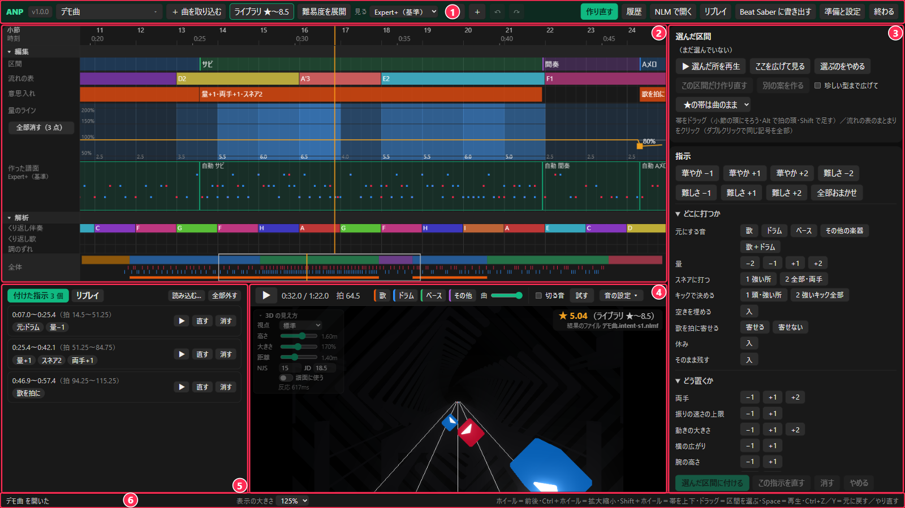

# Auto Note Plotter（ANP）

Beat Saber の譜面を自動で作る Windows アプリです。曲を「歌・ドラム・ベース・その他」の音に分けて曲を理解し、
ノーツの置き方は **BeatLeader のランク譜面から集めた「型」** を組み合わせて、決まりと計算で決めます（ノーツを置くのに AI は使いません）。
区間ごとに方針（意思入れ）を付けて作り直し、Beat Saber で遊べる形に書き出せます。作った譜面は
[Non-Linear Mapper（NLM）Oz-Co2版](https://github.com/Oz-Co-two/nlm-oz-co2) のプロジェクトファイル（.nlmf）なので、NLM で開いて手直し・ライティングもできます。

はじめて使う方は、まず **[チュートリアル](docs/tutorial.md)** をどうぞ。インストールから、曲の取り込み・意思入れ・難易度の作り分け・
Beat Saber への書き出しまでを、画像付きで順番に説明しています。版ごとの変更は [リリースノート](docs/リリースノート.md) にあります。



## できること

- **曲を入れるだけで最初の譜面まで**: 音源を 4 つの音に分け、テンポ・構成（NLM と同じ解析）を調べて、歌・ドラムの打点と盛り上がり・くり返しに合わせて打ちます。
- **意思入れで作り直す**: 区間ごとに「元にする音」「量」「両手」「休み」「歌を拍に寄せる」などの方針を付け、何度でも作り直せます（変えていない所は前の譜面のまま）。
- **難易度をまとめて作る**: 基準の難易度から上下の難易度を作り、★（BeatLeader の★の近似）・NJS・見え始める距離（JD）も決めます。
- **Beat Saber に書き出す**: 曲の情報・カバー・プレイリストごと、Beat Saber の譜面フォルダへ直接書き出します。
- **遊んだリプレイを見ながら直す**: BeatLeader のリプレイを、譜面と再生位置をそろえてアプリの中で見られます。
- **NLM で仕上げる**: NLM で手直ししたクリップは、アプリで作り直しても残ります。

## 動かすのに要る物

- Windows（64 ビット）。Windows 11 で確かめています。
- 音を分ける部品（初めて開いた時にアプリの中からダウンロード・GPU 版は NVIDIA のグラフィックボード向け）。
- NLM（任意・手直しとライティングに）・BeatLeader の Mod（任意・リプレイを見る時に）。

★の値・型のライブラリは BeatLeader の公開されている情報と計算からの近似で、BeatLeader・BeatSaver の公式の道具ではありません。

> **English**: Auto Note Plotter is a free Windows app that generates Beat Saber maps from a song without AI models — note placement comes
> from patterns collected from BeatLeader ranked maps, plus rules and scoring. You set per-section intentions and regenerate; maps export
> straight to Beat Saber or open in Non-Linear Mapper. The app and its docs are in Japanese for now.

## ダウンロード

[リリースのページ](https://github.com/Oz-Co-two/AutoNotePlotter/releases/latest) から `AutoNotePlotter-<版>-win-x64.zip` をダウンロードして展開し、
`AutoNotePlotter.exe` を開きます。初めて開いた時に、曲を理解するための部品（GPU 版 約 3.1GB・CPU 版 約 0.5GB）をダウンロードします。
新しい版はアプリの中で更新できます。

## 開発（ソースから動かす）

開発のリポジトリ名は nlm-automap です。開発の決まりと構成は [CLAUDE.md](CLAUDE.md)、検討の中身は [docs/方針.md](docs/方針.md)、
アプリの仕様は [docs/アプリ仕様.md](docs/アプリ仕様.md)、配布物の作り方は [tools/dist/README.md](tools/dist/README.md) にあります。

```
py -3.14 -m venv .venv
.venv\Scripts\python.exe -m pip install -r requirements-dev.txt
.venv\Scripts\python.exe app\server.py
```

音を分ける部品は別の環境（`.venv-sep`・`requirements-sep.txt`）か、アプリの準備の窓からインストールします。

### テスト

```
.venv\Scripts\python.exe -m pytest -q
```

## ライセンス

GPLv3（[LICENSE](LICENSE)）。ただし音を分ける道具（`tools/separate.py`・`tools/sep_install.py`）は MIT です。
写した物（NLM の曲の解析・書き出し・3D の見え方 ほか）と使っている部品のライセンスは [THIRD_PARTY_NOTICES.md](THIRD_PARTY_NOTICES.md) にあります。
