# チュートリアル：はじめての曲から Beat Saber で遊ぶまで

Auto Note Plotter（ANP）で曲を取り込み、方針（意思入れ）を決めて譜面を作り直し、Beat Saber で遊べる形に書き出して、遊んだリプレイを見ながら直すまでを、順番に説明します。
文章と画像は v1.0.0 に合わせています。

> **画像について**
> 画像の曲は、このチュートリアルのために合成した「デモ曲」です（取り込み中・曲を選ぶ・リプレイの画像には、同じデモ曲を別の名前「デモ曲 2」「デモ曲 3」で取り込んだ物も写っています）。
> 画像はブラウザで撮影したもので、アプリではウィンドウの枠（タイトルバー）が付きます。画面全体の画像は、幅 1920 の窓（表示の大きさ 125%）で撮って縮めた物です。窓が狭いと、上の列は 2 段になります。
> インストール中・作業フォルダの引っ越し・アプリの更新の画像は、説明のために作った中身を表示しています。リプレイ（プレイヤー「Player」）も、デモ曲の譜面に合わせて説明のために作った物です。
> 区間の点検の画像の白い説明の箱は、マウスを乗せた時に出る字を画像の上に描いた物です。
> 書き出し先・リプレイの置き場・音源の場所は、画像の上で書き換えています。

## 目次

0. [このアプリのしくみ](#0-このアプリのしくみ)
1. [インストールと最初の準備](#1-インストールと最初の準備)
2. [画面の見方](#2-画面の見方)
3. [曲を取り込む](#3-曲を取り込む)
4. [できた譜面を見る・聞く](#4-できた譜面を見る聞く)
5. [意思入れ：区間ごとに方針を決める](#5-意思入れ区間ごとに方針を決める)
6. [作り直す・前の版に戻す・別の案](#6-作り直す前の版に戻す別の案)
7. [型のライブラリを変える](#7-型のライブラリを変える)
8. [難易度を作り分ける（展開）](#8-難易度を作り分ける展開)
9. [Beat Saber に書き出す](#9-beat-saber-に書き出す)
10. [遊んだリプレイを見る](#10-遊んだリプレイを見る)
11. [NLM で仕上げる](#11-nlm-で仕上げる)
12. [設定・作業フォルダの引っ越し・更新](#12-設定作業フォルダの引っ越し更新)
13. [困った時は](#13-困った時は)

---

## 0. このアプリのしくみ

Auto Note Plotter は、Beat Saber の譜面を自動で作るアプリです。作るのは次の 2 段です。

1. **曲を理解する**: 曲を「歌・ドラム・ベース・その他」の 4 つの音に分け、歌が入る所・ドラムが鳴る所・盛り上がる所・同じ音楽がくり返す所を調べます。
   ここがノーツを置くタイミングの手がかりになります。
2. **ノーツを置く**: どこに置くか・左右どちらの手で切るか・どの向きに切るかを、**BeatLeader のランク譜面から集めた「型」**
   （人が作った譜面によく出てくる、数回の振りのまとまり）を組み合わせて、決まりと計算で決めます。**ノーツを置くのに AI（学習済みのモデル）は使いません。**

学習済みのモデルを使うのは、次の 2 つの部品だけです。どちらも譜面は作りません。

| 部品 | 何をするか |
|---|---|
| 音を分ける部品（Demucs・PyTorch） | 曲を 4 つの音に分ける（曲を理解するため） |
| ★を測る部品（nlm-rating） | できた譜面の難しさ（★）を BeatLeader と同じ計算で見積もる（BeatLeader の計算に入っている学習済みのモデルをそのまま使う） |

自動で作った譜面に、**人が方針を足して作り直す**のがこのアプリの使い方です。「この区間はドラムに合わせる」「サビは両手を増やして華やかに」
「ここは休み」のような指示（**意思入れ**）を区間ごとに付けると、それを守るように計算し直します。
できた譜面は、NLM（[Non-Linear Mapper Oz-Co2 版](https://github.com/Oz-Co-two/nlm-oz-co2)）のプロジェクトファイル（.nlmf）として保存されるので、
NLM で開いて手直しやライティングもできます。
Beat Saber で遊んだ後は、BeatLeader のリプレイを譜面と並べて見て、直したい所を探せます（[10 章](#10-遊んだリプレイを見る)）。

---

## 1. インストールと最初の準備

### インストール

1. [リリースのページ](https://github.com/Oz-Co-two/AutoNotePlotter/releases/latest) から `AutoNotePlotter-<版>-win-x64.zip` をダウンロードします（約 230MB）。
2. 好きな場所に展開します。インストーラーはありません。展開したフォルダごと、あとから別の場所へ移してもかまいません。
3. フォルダの中の `AutoNotePlotter.exe` をダブルクリックします。

> 初めて起動した時に「Windows によって PC が保護されました」と出ることがあります。アプリに署名が無いためです。
> 「詳細情報」を押してから「実行」を押してください。

### 準備の窓

初めて起動すると、**準備の窓**が開きます。上から順に決めていきます。

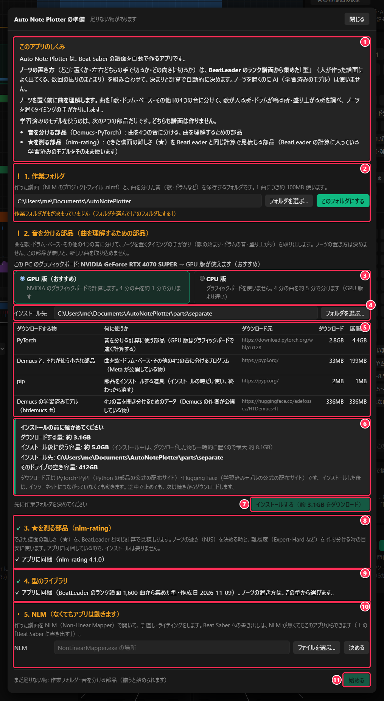

| 番号 | 名前 | 何をするか |
|---|---|---|
| ① | このアプリのしくみ | [0 章](#0-このアプリのしくみ) と同じ説明です |
| ② | 1. 作業フォルダ | 作った譜面（.nlmf）と、曲を分けた音を保存するフォルダです。1 曲につき約 100MB 使います。「フォルダを選ぶ…」で選び、「このフォルダにする」を押します |
| ③ | GPU 版／CPU 版 | 音を分ける部品の種類です。上の行に、この PC のグラフィックボードと、おすすめの種類が出ます |
| ④ | インストール先 | 音を分ける部品を置くフォルダです（初めは作業フォルダの中） |
| ⑤ | ダウンロードする物 | 部品ごとに、何に使うか・ダウンロード元・ダウンロードの量・展開後の大きさ |
| ⑥ | インストールの前に確かめてください | ダウンロードする量・インストール後に使う容量・インストール先・そのドライブの空き容量 |
| ⑦ | インストールする | 作業フォルダを決めると押せます |
| ⑧ | 3. ★を測る部品 | アプリに同梱しているので、インストールは要りません |
| ⑨ | 4. 型のライブラリ | アプリに同梱しています（BeatLeader のランク譜面から集めた型） |
| ⑩ | 5. NLM | 持っていれば `NonLinearMapper.exe` の場所を選びます。無くてもアプリは動きます |
| ⑪ | 始める | 全部揃うと押せます。左に、まだ足りない物が出ます |

### 音を分ける部品をインストールする

| 種類 | ダウンロード | 展開後 | 4 分の曲を分ける時間 |
|---|---|---|---|
| GPU 版（NVIDIA のグラフィックボードがある時） | 約 3.1GB | 約 5.0GB | 約 1 分 |
| CPU 版 | 約 0.5GB | 約 1.0GB | 約 5 分 |

⑥ の量を確かめてから「インストールする」を押します。ダウンロード元は PyTorch・PyPI（Python の部品の公式の配布サイト）・Hugging Face（学習済みモデルの公式の配布サイト）です。

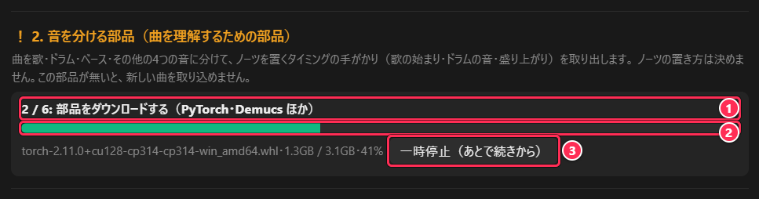

| 番号 | 何が出ているか |
|---|---|
| ① | 今の段（全部で 6 段。ダウンロード → 壊れていないかの確かめ → インストール → 学習済みモデルのダウンロード → 試しに動かす） |
| ② | 進み具合とダウンロード済みの量 |
| ③ | 一時停止（あとで続きから） |

- 一時停止したり、アプリを閉じたりしても、次に開いた時に**続きから**インストールできます（ダウンロード済みの所は取り直しません）。
- インストールした後は、インターネットにつながっていなくても動きます。

全部に ✓ が付いたら、⑥ の「始める」を押します。

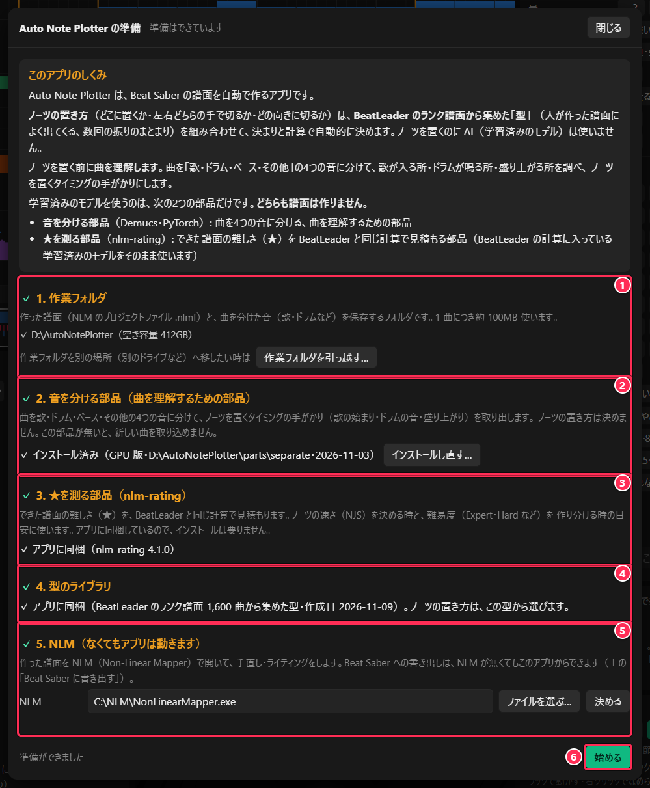

| 番号 | 何が出ているか |
|---|---|
| ① | 作業フォルダ（空き容量・「作業フォルダを引っ越す…」） |
| ② | 音を分ける部品（インストール済み・「インストールし直す…」） |
| ③ | ★を測る部品 |
| ④ | 型のライブラリ |
| ⑤ | NLM の場所 |
| ⑥ | 始める |

> アプリは**起動するたびに**、作業フォルダ・音を分ける部品・★を測る部品・型のライブラリが揃っているかを確かめます。
> 足りない物があれば準備の窓が開き、上の列の「準備と設定」のボタンが「⚠ 準備が足りない」に変わります。

---

## 2. 画面の見方

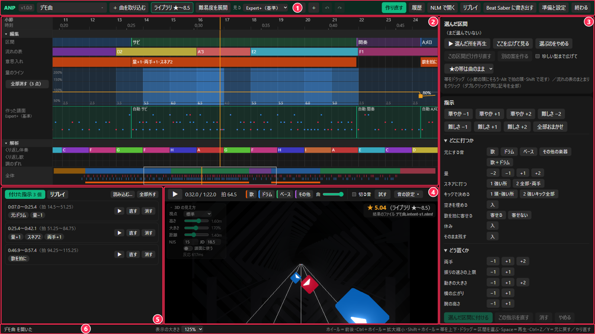

| 番号 | 名前 | 役割 |
|---|---|---|
| ① | 上の列 | 曲を選ぶ・取り込む・作り直す・書き出すなどのボタン（下の表） |
| ② | タイムライン | 曲の時間に沿って、区間・流れの表・意思入れ・量のライン・作った譜面などを帯で並べます。一番下の「全体」は曲全体の見取り図です |
| ③ | 右の欄 | 選んだ区間に付ける指示です（[5 章](#5-意思入れ区間ごとに方針を決める)） |
| ④ | 3D | Beat Saber に近い見た目で、作った譜面が流れます。上に再生と音の操作、左上に見え方の設定、右上に★と結果のファイルの名前が出ます（下の「3D の窓」） |
| ⑤ | 付けた指示／リプレイ | 区間に付けた指示の一覧です。▶ でその区間を鳴らし、「直す」「消す」で直せます。見出しの「リプレイ」に切り替えると、遊んだリプレイを譜面とそろえて見られます（[10 章](#10-遊んだリプレイを見る)） |
| ⑥ | 知らせの行 | 今の様子・表示の大きさ・操作の説明が出ます |

帯と 3D の境目・付けた指示と 3D の境目・右の欄の幅は、ドラッグで変えられます（境目をダブルクリックすると元に戻ります）。

### 上の列

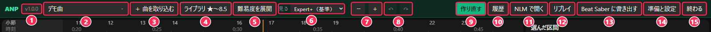

| 番号 | ボタン | 何をするか |
|---|---|---|
| ① | 版（v1.0.0） | アプリの版と更新（[12 章](#アプリの更新)） |
| ② | 曲の名前 | 押すと「曲を選ぶ」窓が開きます（Ctrl＋O・下の「曲を選ぶ」） |
| ③ | ＋ 曲を取り込む | 新しい曲を取り込みます（[3 章](#3-曲を取り込む)） |
| ④ | ライブラリ | この曲の型のライブラリ（今の設定が字で出ます・[7 章](#7-型のライブラリを変える)） |
| ⑤ | 難易度を展開 | Expert・Hard などの難易度を作り分けます（[8 章](#8-難易度を作り分ける展開)） |
| ⑥ | 見る | タイムラインと 3D・★に出す難易度 |
| ⑦ | －／＋ | タイムラインを縮める・広げる（広げ具合は曲ごとに覚えます） |
| ⑧ | ↶／↷ | 元に戻す・やり直す |
| ⑨ | 作り直す | 付けた指示を効かせて作り直します（[6 章](#6-作り直す前の版に戻す別の案)） |
| ⑩ | 履歴 | 前に作った版に戻します |
| ⑪ | NLM で開く | 作った譜面を NLM で開きます（NLM の場所を決めた時だけ押せます） |
| ⑫ | リプレイ | Beat Saber で遊んだリプレイの一覧です（[10 章](#10-遊んだリプレイを見る)） |
| ⑬ | Beat Saber に書き出す | Beat Saber で遊べる形に書き出します（[9 章](#9-beat-saber-に書き出す)） |
| ⑭ | 準備と設定 | 準備の窓（設定・作業フォルダの引っ越し） |
| ⑮ | 終わる | アプリを終わります |

### 3D の窓

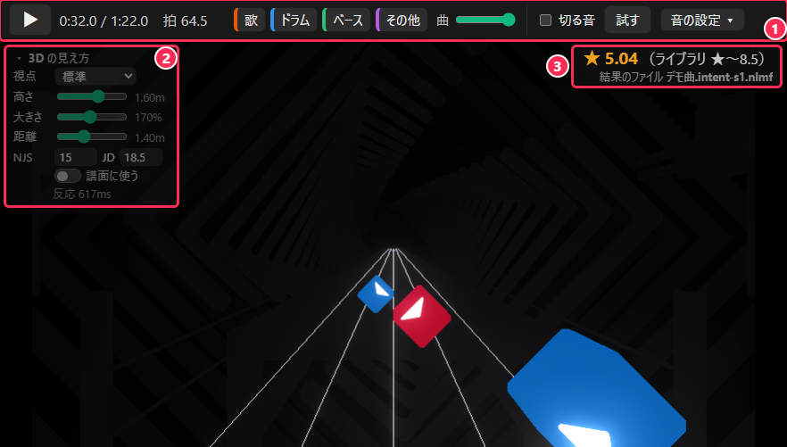

| 番号 | 場所 | 何があるか |
|---|---|---|
| ① | 上の段（再生と音） | ▶（再生・停止）・今の時刻と拍・歌／ドラム／ベース／その他（鳴らすパートの入り切り）・曲の音量（切る音を聞きやすくする時に下げます）・切る音の入り切りと「試す」。窓が狭い時は、切る音の細かい設定（音の種類・左右で変える・音量・ずれ）が「音の設定 ▾」にまとまります |
| ② | 左上（3D の見え方） | 視点・高さ・大きさ・距離（目の位置）・NJS・JD・反応（ノーツが見え始めてから当たるまでの時間）。見出しを押すとたためます。ここを変えても譜面は変わりません（NJS の「譜面に使う」だけは別・[8 章](#njs-と見え始める距離)） |
| ③ | 右上 | 作った譜面の★の目安・結果のファイルの名前・まだ作り直していない指示の知らせ |

### 曲を選ぶ

上の列の曲の名前を押すか Ctrl＋O で、「曲を選ぶ」窓が開きます。

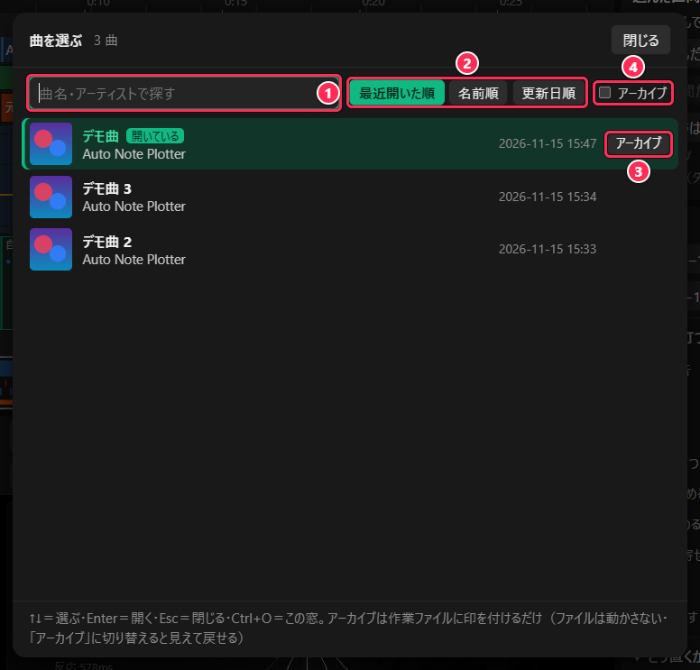

| 番号 | 何をするか |
|---|---|
| ① | 「曲名・アーティストで探す」に字を入れると絞り込めます（全角と半角・ひらがなとカタカナの違いは気にしません） |
| ② | 並びを「最近開いた順」「名前順」「更新日順」から選びます |
| ③ | 行の「アーカイブ」を押すと、その曲を普段の一覧に出さなくなります（ファイルは動かしません） |
| ④ | 「アーカイブ」にチェックを入れると、アーカイブした曲が出て、「戻す」で戻せます |

### 保存について

保存のボタンはありません。付けた指示や設定は、変えると自動で保存します（Ctrl＋S ですぐ保存もできます）。
譜面（.nlmf）は、作り直す・展開する・書き出すなどの操作が終わった時に書きます。

### よく使う操作

| 操作 | 何が起きるか |
|---|---|
| Space | 再生・停止 |
| 1〜4 | 歌・ドラム・ベース・その他の音の入り切り（Shift＋数字でそれだけ・0 で全部） |
| ← ／ → | 5 秒戻る・進む（Shift を押しながらで 1 秒） |
| Home | 曲の頭へ |
| ホイール | 曲の中を横に動く |
| Ctrl＋ホイール | 拡大・縮小 |
| Shift＋ホイール | 帯を上下に動かす |
| 帯の上をドラッグ | 区間を選ぶ（小節の頭にそろう・Alt で拍の頭・Shift で足す） |
| クリック | そこへ移る |
| Ctrl＋Z ／ Ctrl＋Y | 元に戻す／やり直す |
| Ctrl＋O | 曲を選ぶ窓 |
| Ctrl＋S | すぐ保存（ふだんは自動で保存します） |
| Esc | 選んだ区間などを外す |

画面の文字が大きすぎる・小さすぎる時は、右下の「表示の大きさ」で変えられます。

---

## 3. 曲を取り込む

上の列の「＋ 曲を取り込む」を押します。

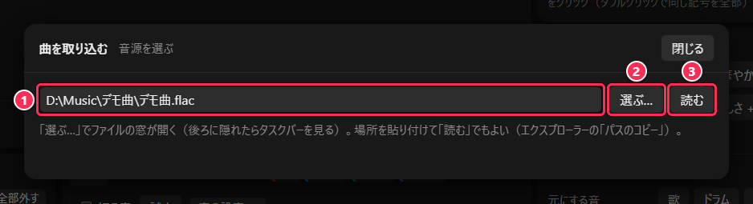

| 番号 | 何をするか |
|---|---|
| ① | 音源のファイルの場所（エクスプローラーの「パスのコピー」を貼り付けてもかまいません） |
| ② | 選ぶ…（ファイルを選ぶ窓が開きます） |
| ③ | 読む（① に入れた場所の音源を読みます） |

使える音源は flac・wav・mp3・ogg です（m4a などは ffmpeg が要ります）。読むと、確かめの画面になります。

> ネットワークの場所（`\\` で始まる場所）にある音源は、作業フォルダに写してから使います（NLM で開いても音が鳴るように）。

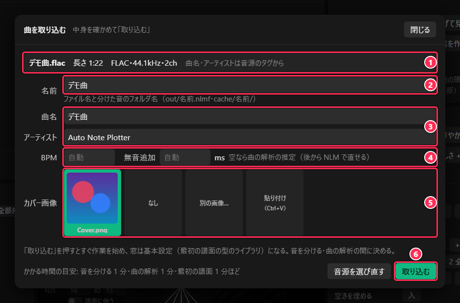

| 番号 | 何をするか |
|---|---|
| ① | 音源の情報（長さ・形式。曲名・アーティストは音源のタグから入ります） |
| ② | 名前（保存するファイルと、分けた音のフォルダの名前） |
| ③ | 曲名・アーティスト |
| ④ | BPM・無音追加（空のままなら曲の解析が決めます。後から NLM で直せます） |
| ⑤ | カバー画像（音源と同じフォルダの画像・なし・別の画像…・コピーした画像の貼り付け） |
| ⑥ | 取り込む |

「取り込む」を押すと作業が始まり、窓は**基本設定**になります。ここで、最初の譜面に使う**型のライブラリ**（どの譜面から型を取るか）を決めます。
迷ったら、初めの値のままで大丈夫です。あとで [7 章](#7-型のライブラリを変える) の窓で変えられます。

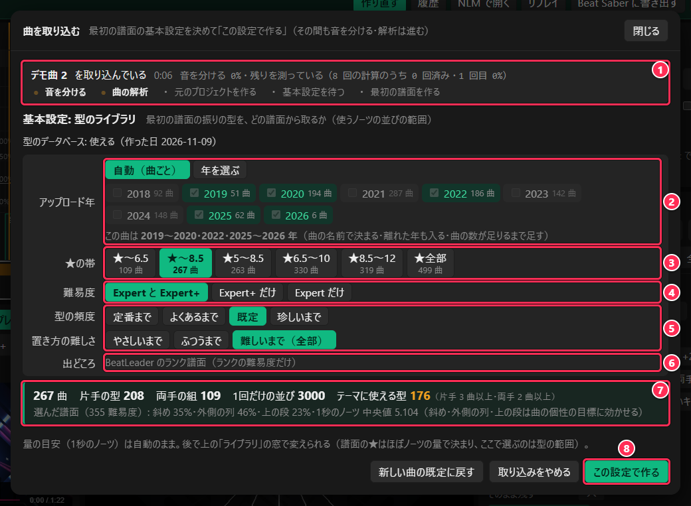

| 番号 | 何が出ているか・何をするか |
|---|---|
| ① | 取り込みの進み具合（基本設定を決めている間も、音を分ける・曲の解析は進みます） |
| ② | アップロード年（型を取る譜面の年。「自動（曲ごと）」なら曲ごとに年を選びます・[7 章](#アップロード年の選び方)） |
| ③ | ★の帯（型を取る譜面の★の範囲。下に、選んだ年の中のその帯の曲の数） |
| ④ | 難易度（型を取る難易度） |
| ⑤ | 型の頻度・置き方の難しさ |
| ⑥ | 出どころ（BeatLeader のランク譜面） |
| ⑦ | 選んだ範囲の数（曲・片手の型・両手の組・テーマに使える型） |
| ⑧ | この設定で作る |

> アップロード年は、取り込むたびに「自動（曲ごと）」から始まります（★の帯などは、前に取り込んだ時の選びを覚えています）。

「この設定で作る」を押すと、段ごとに進みます。

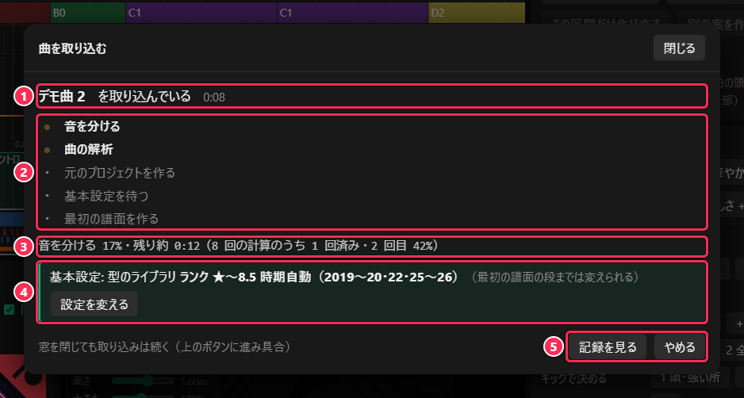

| 番号 | 何が出ているか |
|---|---|
| ① | 取り込んでいる曲と経過時間 |
| ② | 段の並び（音を分ける → 曲の解析 → 元のプロジェクトを作る → 基本設定を待つ → 最初の譜面を作る。✓ は済み・● は今） |
| ③ | 今の段の様子 |
| ④ | 決めた基本設定（最初の譜面を作り始めるまでは「設定を変える」で変えられます） |
| ⑤ | 記録を見る・やめる |

GPU 版なら 4 分の曲で数分です（デモ曲は 30 秒ほどでした）。窓を閉じても取り込みは続きます（上の「＋ 曲を取り込む」のボタンに進み具合が出ます）。
終わると、できた譜面が開きます。

> 曲の解析は、テンポ（BPM）・無音追加・曲の構成（イントロ・Aメロ・サビ…）を決めます。区間の名前と境目がずれていたら、
> NLM で開いてマーカーを直して保存すると、次の作り直しから効きます。

---

## 4. できた譜面を見る・聞く

- 3D の窓の上の ▶（Space）で再生すると、3D に譜面が流れ、ノーツを切る音が鳴ります。
- 「歌」「ドラム」「ベース」「その他」のボタンで、鳴らすパートを入り切りできます。ドラムだけにすると、ノーツがドラムに合っているかが分かります。
- タイムラインの帯「作った譜面」に、ノーツが並びます。帯「区間」は曲の構成、「流れの表」は同じ音楽のくり返し（同じ記号＝同じ音楽）です。
  帯「作った譜面」の金色の「決」は、珍しい型を 1 回だけ使った**決め**の場所です。
- 帯「作った譜面」の下の端の細い色の帯は、**同じ音楽がくり返す所**です。アプリは、同じ音楽には同じ振りを当てます。
  札「手本」は 1 回目（濃い色）、「同じ」は手本と同じ置き方（薄い色）、「反転」は手本を左右反転した置き方（斜めの縞）です（例「自動1 手本」）。
  マウスを乗せると、組の名前・小節の数・同じ組のほかの回が出ます。押すと、その回の区間を選びます（Shift で足す）。
- 3D の窓の右上の ★ に、作った譜面の★の目安が出ます（BeatLeader の★の近似で、公式の値ではありません）。
- 3D の見え方の NJS を変えても、譜面は変わりません（見え方だけ）。譜面の NJS にしたい時は「譜面に使う」を入れます（[8 章](#njs-と見え始める距離)）。

---

## 5. 意思入れ：区間ごとに方針を決める

### 区間を選んで指示を付ける

タイムラインの帯の上を**ドラッグ**して区間を選び、右の欄で指示を選びます。押さない項目は「おまかせ」です。

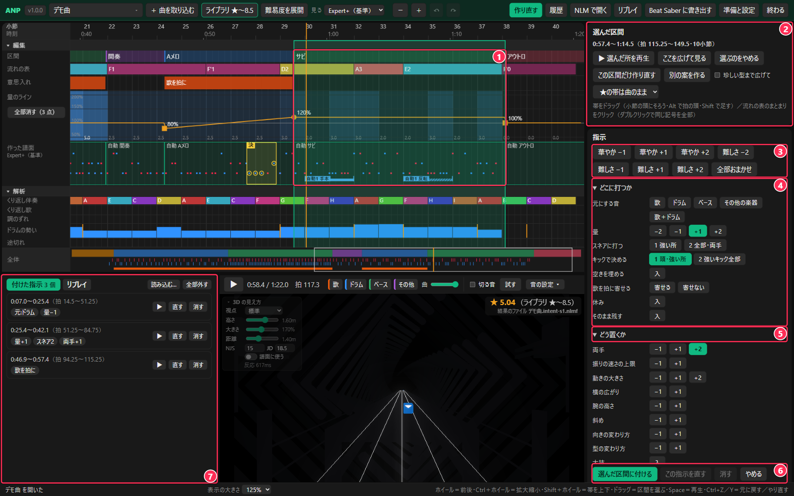

| 番号 | 名前 | 何をするか |
|---|---|---|
| ① | 選んだ区間 | 帯の上をドラッグして選んだ区間（小節の頭にそろいます） |
| ② | 選んだ区間の欄 | 選んだ所を再生・ここを広げて見る・選ぶのをやめる・この区間だけ作り直す・別の案を作る |
| ③ | まとめボタン | 華やか −1〜+2・難しさ −2〜+2（いくつかの指示をまとめて入れます）・全部おまかせ |
| ④ | どこに打つか | 下の表 |
| ⑤ | どう置くか | 下の表 |
| ⑥ | 選んだ区間に付ける | 指示を区間に付けます（「この指示を直す」「消す」「やめる」も） |
| ⑦ | 付けた指示 | 付けた指示の一覧。帯「意思入れ」にも出ます |

指示は、作り直した時に効きます（[6 章](#6-作り直す前の版に戻す別の案)）。

**どこに打つか**

| 指示 | 値 | 意味 |
|---|---|---|
| 元にする音 | 歌／ドラム／ベース／その他の楽器／歌＋ドラム | 打点をどの音から拾うか（おまかせ＝歌のある所は歌・無い所はドラムと楽器） |
| 量 | −2〜+2 | ノーツの数（−2＝1 拍に 1 つまで … +2＝1/4 拍まで） |
| スネアに打つ | 1 強い所／2 全部・両手 | スネア（「タン」の太鼓）の打点を必ずノーツに |
| キックで決める | 1 頭・強い所／2 強いキック全部 | キック（「ドン」の太鼓）の強い打点を両手の振り下ろしに |
| 空きを埋める | 入 | 1 拍以上ノーツの無い所に、ドラム・楽器の打点を足す |
| 歌を拍に寄せる | 寄せる／寄せない | 歌のタイミングが拍とずれて感じる所に。迷った歌の打点を、隣の目盛りでキック・スネアが鳴っていればそちらへ置き直す（ノーツは増やさない）。押さない＝歌が目盛りからばらつく所だけ弱く寄せる |
| 休み | 入 | この区間はノーツを置かない |
| そのまま残す | 入 | 前の譜面のノーツをそのまま残す（NLM で手直しした所を守る） |

**どう置くか**

| 指示 | 値 | 意味 |
|---|---|---|
| 両手 | −1〜+2 | 両手で同時に切る所を減らす・増やす |
| 振りの速さの上限 | −1／+1 | 同じ手で続けて振る間隔の下限（−1＝速い連打を作らない） |
| 動きの大きさ | −1〜+2 | 1 振りごとの腕の移動 |
| 横の広がり | −1／+1 | 内側の 2 列にまとめる／4 列を使い切る |
| 腕の高さ | −1／+1 | 上の段を減らす／増やす |
| 斜め | −1／+1 | 斜めの振りを減らす／増やす |
| 向きの変わり方 | −1／+1 | 真上・真下の往復が中心／45° 曲げる振りを増やす |
| 型の変わり方 | −1／+1 | 同じ型を長く続ける／細かく変える |
| 大技 | 入 | 腕の交差・大きな跳びなどを少し許す |
| 型の幅 | 珍しいまで | 少ない曲にしか出ない型まで広げて選び直す |
| ★の帯 | 1 段やさしく／1 段難しく／帯を直接 | この区間の型を、★の帯を変えた型から選び直す |
| 決め | 入れない／入れる | 1 回だけの珍しい並び（決め）を入れる・入れない |

### 同じ振り

サビの掛け声のように、**同じ音楽には同じ振りを当てたい**時は「同じ振り」を使います。グループの名前（例「掛け声」）を付けた区間には、
毎回同じ打点の並びと置き方を当てます。「アレンジ」にすると、2 回目・4 回目…はノーツを増やした形になります。
右の欄の「盛り上がりの繰り返し」には、同じ振りにできそうな所の候補が出ます。

> 指示を付けなくても、アプリは同じ音楽がくり返す所を見つけて同じ振りにします（帯「作った譜面」の下の端の色の帯・[4 章](#4-できた譜面を見る聞く)）。
> 「同じ振り」は、自分で決めた所をはっきり同じにしたい時に使います。

### 量のライン

帯「量のライン」は、曲の流れに沿って全体のノーツを濃く・薄くする折れ線です（50〜200%）。背景の青の濃さは今の譜面の小節ごとの 1 秒のノーツの数で、量のラインを直してまだ作り直していない小節は橙の網掛けになります。

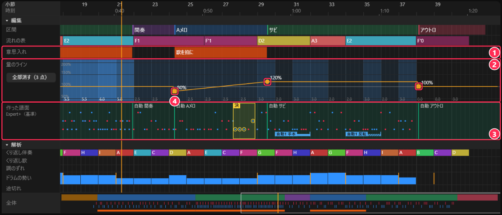

| 番号 | 何が出ているか |
|---|---|
| ① | 帯「意思入れ」（付けた指示） |
| ② | 帯「量のライン」（200%・150%・100%・50% の目盛り） |
| ③ | 帯「作った譜面」（区間ごとのクリップと、金色の「決」） |
| ④ | 量のラインの点（この例では 80% → 120% → 100%） |

| 操作 | 何が起きるか |
|---|---|
| ダブルクリック | 点を足す |
| ドラッグ | 点を動かす |
| 右クリック | 点の形の切り替え（その点から段で変える／なめらかに変える）・消す |
| 帯の見出しの「全部消す」 | 量のラインの点を全部消す（帯の見出し「量のライン」の下にあります。元に戻せます） |

---

## 6. 作り直す・前の版に戻す・別の案

### 作り直す

上の列の「作り直す」を押すと、付けた指示を効かせて譜面を作り直します（曲の長さと PC によりますが、多くは数秒〜数十秒です）。押すと、どちらで作り直すかを聞きます。

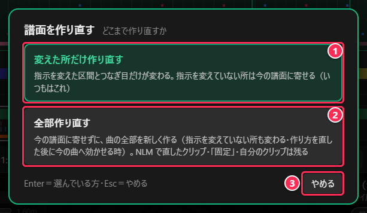

| 番号 | 選び | 何をするか |
|---|---|---|
| ① | 変えた所だけ作り直す | 指示を変えた所だけを新しく作り、ほかは前の譜面に寄せます（ふつうはこちら） |
| ② | 全部作り直す | 曲の全部を新しく作ります |
| ③ | やめる | 作り直しません |

Shift を押しながら「作り直す」を押すと、聞かずに全部作り直します。区間を選んで右の欄の「この区間だけ作り直す」を押すと、その区間だけを作り直します。

作り直している間は、真ん中に進み具合の窓が出ます。

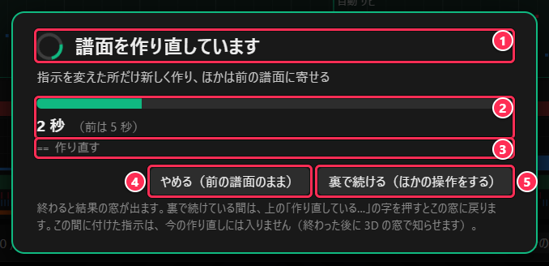

| 番号 | 何が出ているか・何をするか |
|---|---|
| ① | 作り直している所 |
| ② | 進み具合（前に作り直した時の時間から見積もります） |
| ③ | 記録の最後の行 |
| ④ | やめる（作り直す前の譜面に戻します） |
| ⑤ | 裏で続ける（窓を隠して、ほかの操作を続けます） |

終わると、作り直した結果（打点の数・型の出どころ・前の譜面に寄せた所・NLM で直した所など）が出ます。

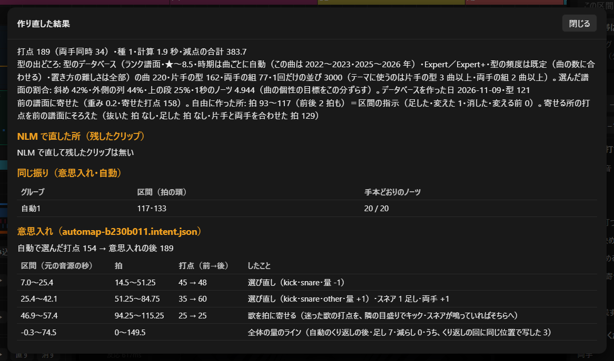

> 指示を変えたのにまだ作り直していない時は、3D の窓の右上に「未反映の意思入れ」の知らせが出ます。

### 前の版に戻す（履歴）

上の列の「履歴」に、作り直した版が並びます。

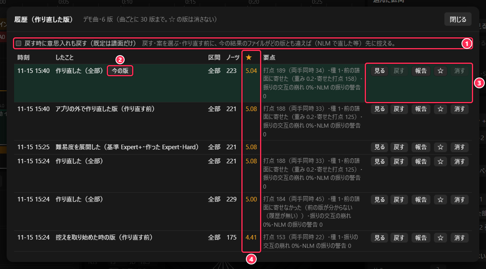

| 番号 | 何が出ているか・何をするか |
|---|---|
| ① | 戻す時に意思入れも戻す（チェックすると、付けた指示もその版の時の物に戻します。既定は譜面だけ） |
| ② | 今の版 |
| ③ | 見る（帯と 3D でその版を見る）・戻す・報告・☆（残す印）・消す |
| ④ | その版の★ |

### 別の案

区間を選んで右の欄の「別の案を作る」を押すと、その区間の型を変えた案をいくつか作ります。案の行を押すと、帯と 3D でその案を見られます。

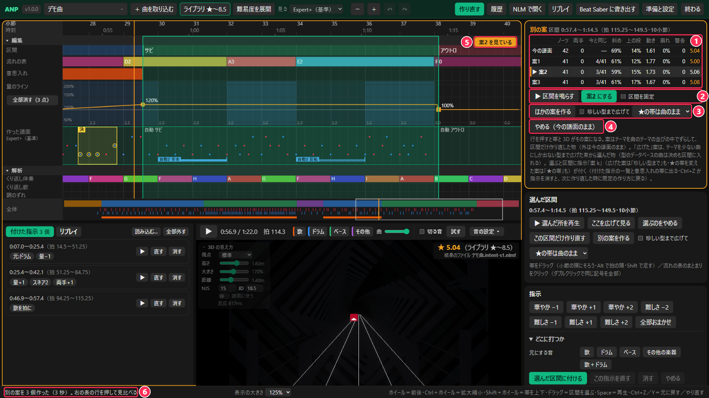

| 番号 | 何が出ているか・何をするか |
|---|---|
| ① | 案の表（今の譜面と案ごとに、ノーツ・両手・今と同じ振りの数・斜め・上の段・動き・崩れ・警告・★） |
| ② | 区間を鳴らす・案2 にする（見ている案に決める）・区間を固定 |
| ③ | ほかの案を作る・珍しい型まで広げて・★の帯を変えて作る |
| ④ | やめる（今の譜面のまま） |
| ⑤ | 今見ている案（タイムラインの縁が橙になります） |
| ⑥ | 知らせ |

---

## 7. 型のライブラリを変える

上の列の「ライブラリ」で、この曲に使う型の範囲を決めます。窓は上から下へ、だんだん細かく絞り込む並びです（年を絞ると、その下の★の帯の曲の数が変わります）。

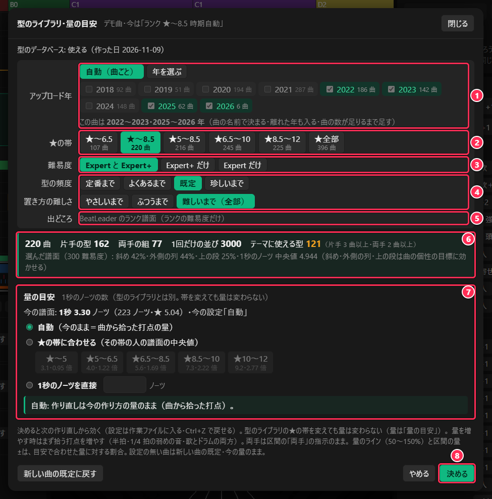

| 番号 | 項目 | 意味 |
|---|---|---|
| ① | アップロード年 | 型を取る譜面の年（BeatSaver に上がった年）。選び方は下の「アップロード年の選び方」 |
| ② | ★の帯 | 型を取る譜面の★の範囲。横の数は、選んだ年の中のその帯の曲の数 |
| ③ | 難易度 | 型を取る難易度（Expert と Expert+／Expert+ だけ／Expert だけ） |
| ④ | 型の頻度・置き方の難しさ | よくある型だけにするか、珍しい型まで使うか・型の形（移動・向きの曲がり・腕の交差など）の難しさの上限 |
| ⑤ | 出どころ | BeatLeader のランク譜面（ランクの難易度だけ）から取ります |
| ⑥ | 数 | 選んだ範囲の曲・型の数 |
| ⑦ | 量の目安 | 1 秒のノーツの数の目安（自動・★の帯に合わせる・数で直接） |
| ⑧ | 決める | 決めた範囲は、次の作り直しから効きます |

### アップロード年の選び方

| 選び | 何が起きるか |
|---|---|
| 自動（曲ごと） | 新しい曲の既定です。曲ごとに年を選びます（中心の年は曲の名前で決まり、離れた年が入ることもあります）。選ばれた年にチェックが付き、「この曲は 2019・2021〜2023 年」のように出ます。自動の間はチェックを変えられません |
| 年を選ぶ | 年ごとのチェックで、使う年を自分で選びます。続いていない年も選べます（例: 2019 年と 2022〜2023 年）。どれも選ばないと全部の年です。自動から切り替えると、自動で選ばれていた年から始まります |

- 譜面の流行は年で変わるので、曲ごとに違う年から型を取ると、曲どうしの振りが似すぎません。
- 年の横の数は、その年の曲の数です（★の帯で絞る前の数）。
- 年を選ぶと、上がった年の分からない譜面は入りません。

> ★はほとんどノーツの量で決まります。難しくしたい・やさしくしたい時は、型の範囲より、⑦ の量の目安や意思入れの「量」を変える方が効きます。

---

## 8. 難易度を作り分ける（展開）

今の譜面（**基準**）から、ほかの難易度（**派生**）を作ります。上の列の「難易度を展開」を押します。

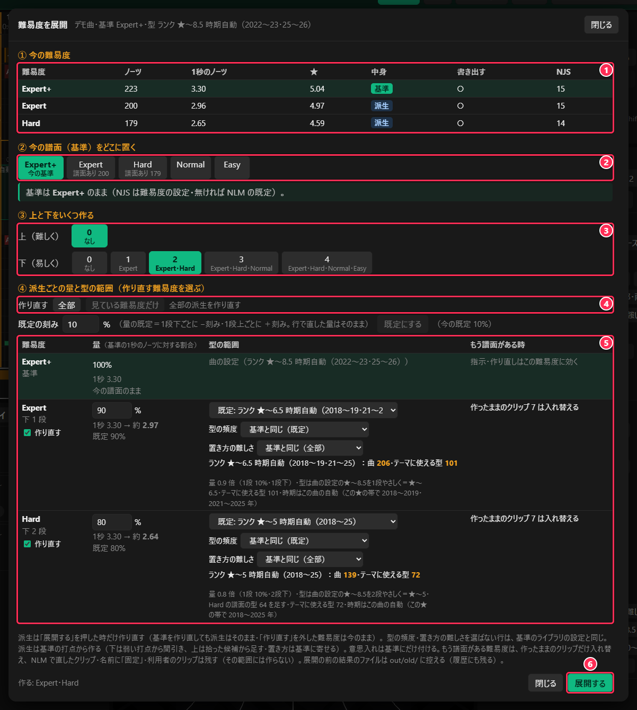

| 番号 | 何が出ているか・何をするか |
|---|---|
| ① | 今の難易度（どれが基準か・ノーツの数） |
| ② | 基準をどの難易度に置くか（例 Hard に置いて、上に Expert・Expert+、下に Normal を作る） |
| ③ | 上と下にいくつ作るか |
| ④ | 作り直す範囲（全部／見ている難易度だけ） |
| ⑤ | 派生ごとの設定（量の割合・型の範囲・型の頻度・置き方の難しさ。もう譜面がある時の扱い） |
| ⑥ | 展開する |

- 量は 1 段ごとに ±10% が既定です。下の難易度は基準の打点から弱い所を間引いて、上の難易度は打点を足して作ります。置き方は基準に寄せます。
- 基準で同じ音楽がくり返す所（[4 章](#4-できた譜面を見る聞く) の色の帯）は、派生でもそろえます。足す・間引く・両手にする所はどの回も同じにし、置き方は手本の回に合わせます。
  派生を見ている時も、帯「作った譜面」の下の端に、その難易度でそろえた組が出ます。
- NJS（ノーツの速さ）と見え始める距離（JD）は、難易度ごとに決めて書きます（下の「NJS と見え始める距離」）。

上の列の「見る」で派生の難易度を選ぶと、タイムラインと 3D・★がその難易度になります。左下の欄でリプレイを開いた時も、そのリプレイの難易度に切り替わります（[10 章](#10-遊んだリプレイを見る)）。

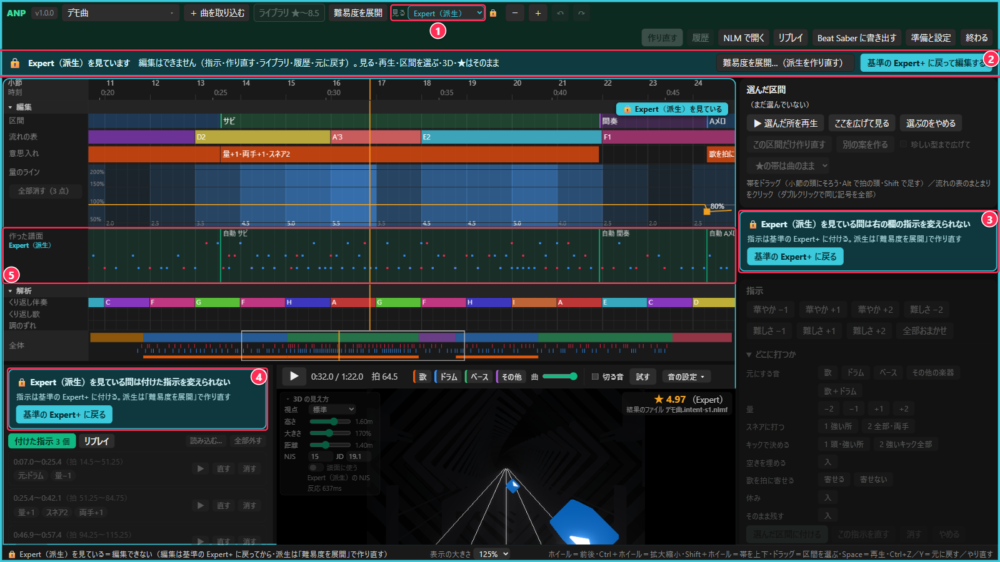

| 番号 | 何が出ているか |
|---|---|
| ① | 見る（派生の難易度を選んでいる） |
| ② | 「派生を見ています」の帯（「難易度を展開…」「基準の ○○ に戻って編集する」） |
| ③ | 右の欄の覆い |
| ④ | 付けた指示の覆い |
| ⑤ | 帯「作った譜面」（派生の譜面） |

> **派生を見ている間は編集できません。** 指示は基準の難易度に付けて作り直し、派生は「難易度を展開」で作り直します。
> 「基準の ○○ に戻って編集する」を押すと戻れます。

### NJS と見え始める距離

- **NJS（ノーツの速さ）** は、★・BPM・難易度から決めます（BeatLeader のランク譜面の傾向から作った式）。作り直し・展開のたびに書きます。NLM で直した値は上書きしません。
- 一緒に、**ノーツが見え始める距離（JD）** が難易度ごとのちょうどよい長さ（最近のランク譜面によくある長さ）になるように、オフセットも書きます。
  Beat Saber では、BPM と NJS の組み合わせによって、NJS を少し変えただけで見え始める距離が倍や半分に跳ぶことがあります。オフセットを合わせておくと、これが起きません。
  NLM で決めたオフセットは上書きしません。
- 3D の NJS を変えて見ている時も、アプリが決めたオフセットの難易度なら、JD はその難易度のちょうどよい長さのままです。JD の欄に数を入れると、その JD のままになります。

**3D で速さを決める**

3D で流して速さを確かめ、ちょうどよい NJS を譜面に使うこともできます。

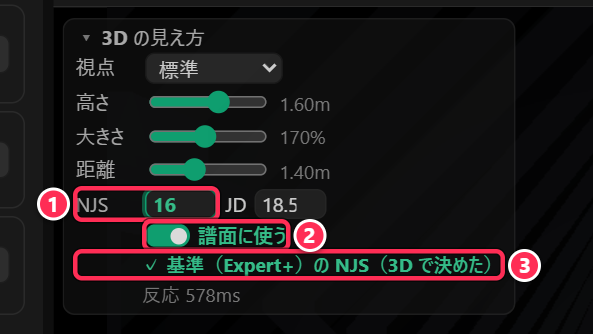

1. 基準の難易度を見ている時に、3D の見え方の「NJS」（①）を変えて、ちょうどよい速さを探します。
2. NJS の下の「譜面に使う」（②）を入れます。その値が基準の難易度の NJS になり、すぐ譜面（.nlmf）に書きます（作り直しても変わりません）。
   下に「✓ 基準（Expert+）の NJS（3D で決めた）」のように出ます（③）。
3. これから「難易度を展開」で作る派生は、決めた値から式の上下の間隔でずらした NJS になります。作ってある派生は変わらないので、合わせたい時は展開し直すか、NLM で直してください。

- 「譜面に使う」を切ると、式の値に戻ります。
- 基準の NJS を後から NLM で直した時は、NLM の値が使われます（3D に橙の字で「NLM で ○○ に直した値を基準に使っている」と出ます）。
  その後に 3D で値を変える・「譜面に使う」を入れ直すと、3D の値になります（後から決めた方が使われます）。
- 派生を見ている時・履歴の版や別の案を見ている時・作り直している間は、「譜面に使う」は押せません。

### 区間の点検

タイムラインの「比べる」を開くと、帯「区間の点検」に、区間ごとに人の譜面との近さや、区間どうしの似かたが出ます。どの区間を作り直すかの目安に使えます。

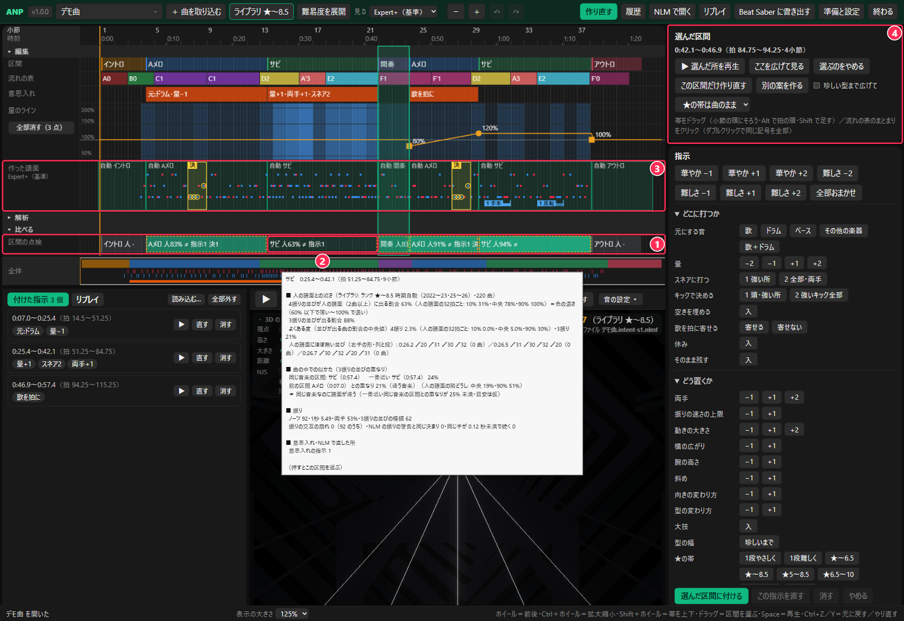

| 番号 | 何が出ているか |
|---|---|
| ① | 帯「区間の点検」（区間ごとに、人の譜面に出る並びの割合・付けた指示・決め） |
| ② | 区間の上に乗せると出る説明 |
| ③ | 帯「作った譜面」の決めの場所 |
| ④ | 点検の帯を押して選んだ区間 |

---

## 9. Beat Saber に書き出す

上の列の「Beat Saber に書き出す」を押します。NLM が無くても書き出せます。

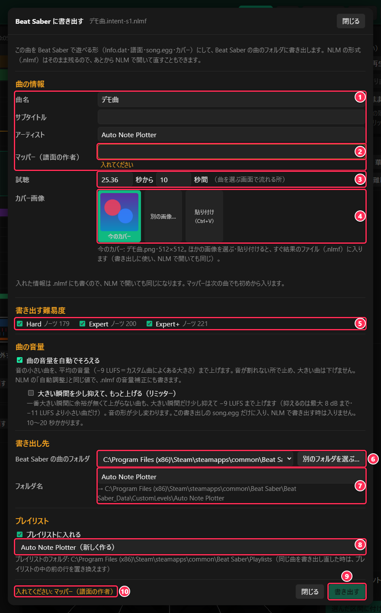

| 番号 | 項目 | 何をするか |
|---|---|---|
| ① | 曲の情報 | 曲名・サブタイトル・アーティスト。入れた情報は .nlmf にも書くので、NLM で開いても同じです |
| ② | マッパー | 譜面の作者の名前（**必須**）。次の曲でも初めから入ります |
| ③ | 試聴 | 曲を選ぶ画面で流れる所 |
| ④ | カバー画像 | 今のカバーと、ほかの候補（前に使ったカバー・音源のフォルダの画像）が並びます。「別の画像…」や貼り付けでも変えられます。選ぶとすぐ .nlmf に入ります（NLM で開いても同じ）。無くても書き出せます |
| ⑤ | 書き出す難易度 | 書き出す難易度にチェックを入れます |
| ⑥ | Beat Saber の曲のフォルダ | 書き出し先（CustomLevels）。BSManager・Steam・Oculus の場所を探して候補に出します。「別のフォルダを選ぶ…」でも選べます |
| ⑦ | フォルダ名 | 書き出すフォルダの名前。使えるのは英数字と `- _ . ( ) [ ] & ' ! + ,` だけです（NLM と同じ決まり） |
| ⑧ | プレイリスト | 「プレイリストに入れる」にすると、プレイリストに入れます。既定は「Auto Note Plotter」です。今あるプレイリストや、新しいプレイリストも選べます |
| ⑨ | 書き出す | 足りない物があると押せません |
| ⑩ | 足りない物 | 押せない理由が出ます |

### 曲の音量

書き出す難易度の下の「曲の音量」で、音の小さい曲を聞きやすい大きさにそろえられます（入り切りは次の書き出しでも覚えています）。

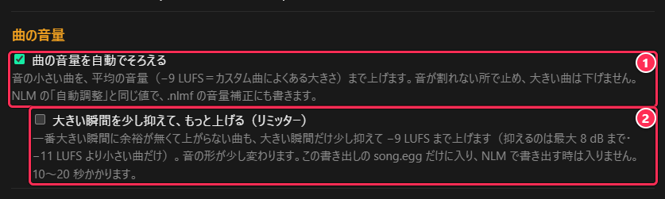

| 番号 | 選び | 何をするか |
|---|---|---|
| ① | 曲の音量を自動でそろえる | 音の小さい曲を、平均の音量（−9 LUFS＝カスタム曲によくある大きさ）まで上げます。音が割れない所で止め、大きい曲は下げません。NLM の「自動調整」と同じ値で、.nlmf の音量補正にも書きます |
| ② | 大きい瞬間を少し抑えて、もっと上げる（リミッター） | 一番大きい瞬間に余裕が無くて上がらない曲も、大きい瞬間だけ少し抑えて −9 LUFS まで上げます（抑えるのは最大 8 dB まで・−11 LUFS より小さい曲だけ）。音の形が少し変わります。このアプリで書き出す song.egg だけに入り、NLM で書き出す時は入りません。10〜20 秒かかります。① を入れると選べます |

「書き出す」を押すと、Info.dat・難易度ごとの譜面・song.egg（音源）・カバー画像を書き出します。

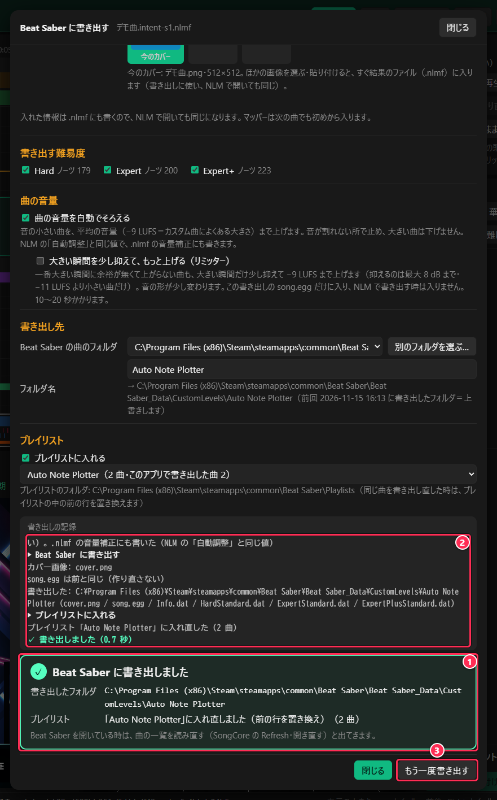

| 番号 | 何が出ているか |
|---|---|
| ① | 書き出したフォルダ・プレイリストに入れたこと |
| ② | 記録（.nlmf にも曲の情報を書いた・song.egg・書き出したファイル） |
| ③ | もう一度書き出す（設定やカバーを変えると「書き出す」に戻ります） |

- 同じ曲を書き出し直すと、同じフォルダに上書きし、プレイリストの中の前の行を置き換えます（同じ曲が 2 つ並びません）。
- 書き出すたびに、書き出した譜面を作業フォルダに控えます。あとで作り直して書き出し直しても、リプレイは遊んだ時の譜面で見られます（[10 章](#10-遊んだリプレイを見る)）。
- Beat Saber を起動したままの時は、曲の一覧を読み直す（SongCore の Refresh・ゲームの再起動）と出てきます。
- 書き出せない時は、窓に理由が出ます。「この譜面は NLM で書き出してください」と出た時は、NLM で開いて NLM から書き出してください
  （NLM のカバー画像の補正など、このアプリが写していない機能が入っています）。

---

## 10. 遊んだリプレイを見る

Beat Saber で遊んだリプレイ（BeatLeader の記録）を、アプリの中で、作った譜面と再生位置をそろえて見られます。
崩れた所・ノーツが少なく感じた所をリプレイで見つけて、そのまま区間を選んで意思入れを付けられます。

リプレイを映すのには、BeatLeader（BL）の Web のリプレイアプリ（BeatSaber-Web-Replays・MIT ライセンス）をアプリに同梱して使っています（このチュートリアルでは「BL のリプレイアプリ」と書きます）。
BeatSaver に上げていない譜面でも、遊んだ時の譜面をアプリが渡すので見られます。

### 準備

- Beat Saber に BeatLeader の Mod を入れて遊ぶと、リプレイ（.bsor）が Beat Saber のフォルダの `UserData\BeatLeader\Replays` に残ります。
- アプリは、書き出し先と同じように BSManager・Steam・Oculus の Beat Saber の場所から、リプレイの置き場を自動で探します。
  見つからない時は、上の列の「リプレイ」の窓の下の「リプレイの置き場」に場所を入れて「この場所にする」を押します（「自動に戻す」で自動に戻ります）。
- アプリで作った曲は、「Beat Saber に書き出す」（[9 章](#9-beat-saber-に書き出す)）で書き出してから遊びます。

### リプレイの一覧

上の列の「リプレイ」を押すと、リプレイの窓が開きます。窓の上で「この曲」と「全部の履歴」を切り替えます。

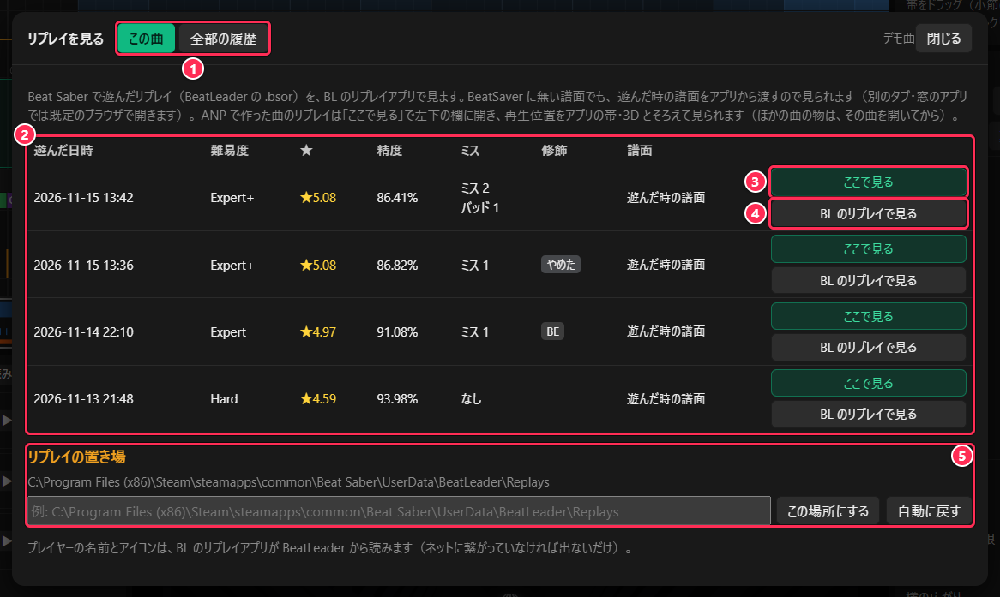

| 番号 | 何が出ているか・何をするか |
|---|---|
| ① | 「この曲」と「全部の履歴」の切り替え（下の表） |
| ② | リプレイの一覧（列は下の表） |
| ③ | ここで見る（左下の欄に開いて、アプリと同期して見る） |
| ④ | BL のリプレイで見る（ブラウザの別のタブで開く） |
| ⑤ | リプレイの置き場（見つからない時は、ここに場所を入れます） |

| 切り替え | 出る物 |
|---|---|
| この曲 | 今開いている曲を遊んだリプレイ（新しい順） |
| 全部の履歴 | どの曲のリプレイも新しい順（アプリで作った曲も、ほかの人の譜面も）。カバー画像・曲名・作者名が付き、アプリで作った曲には「ANP」の印が付きます。「曲名・作者名で探す」「ANP で作った曲だけ」で絞り込めます。100 件ずつ出て、「もっと見る」で続きを出します。アプリで作った曲は「曲を開く」でその曲を開けます |

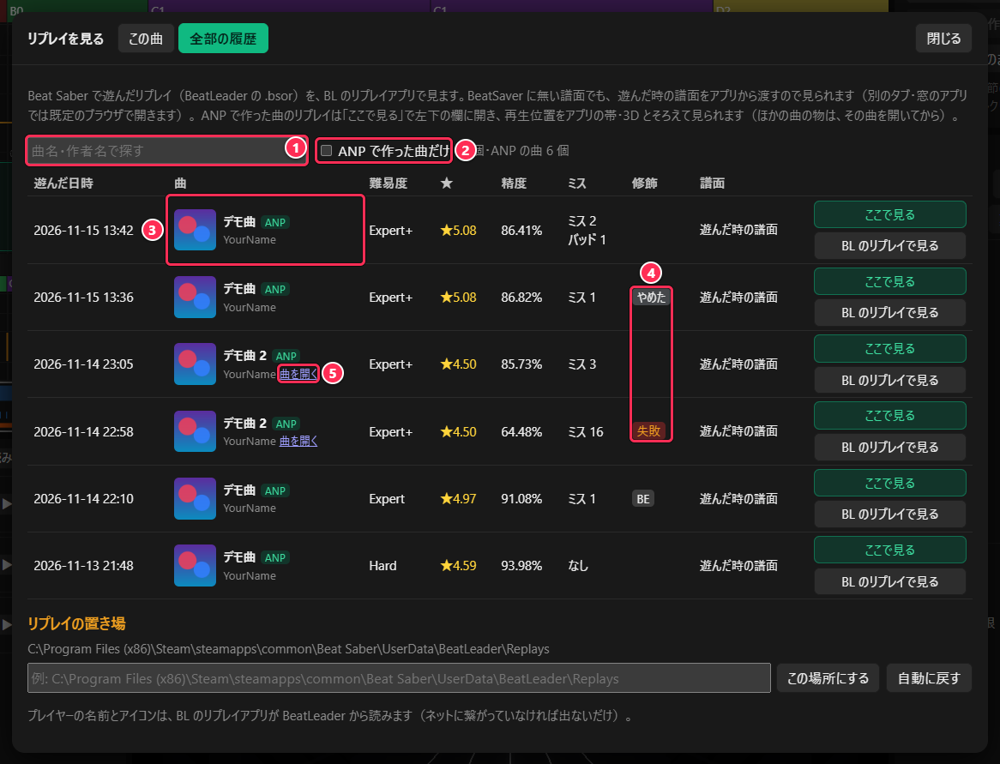

| 番号 | 何が出ているか・何をするか |
|---|---|
| ① | 曲名・作者名で探す |
| ② | ANP で作った曲だけ |
| ③ | 曲（カバー画像・曲名・作者名。アプリで作った曲には「ANP」の印） |
| ④ | 「やめた」「失敗」の札（途中でやめた・途中で失敗したプレイ） |
| ⑤ | 曲を開く（今開いていない、アプリで作った曲を開きます） |

| 列 | 何が出ているか |
|---|---|
| 遊んだ日時 | 遊んだ日と時刻 |
| 難易度 | 遊んだ難易度（Standard でない遊び方は、その名前も） |
| ★ | 遊んだ時の譜面の★の目安（BeatLeader の★の近似・修飾なし）。見えている行から順に測るので、出るまで少しかかります。— は、遊んだ時の譜面が手元に無いなどで測れなかった物 |
| 精度 | 点÷満点の目安（修飾の掛け算も入ります） |
| ミス | ミス・バッド（悪い切り方）・ボム・壁の数 |
| 修飾 | 使った修飾（略号。マウスを乗せると名前）と、「失敗」（途中で失敗した）・「やめた」（途中でポーズからメニューに戻った・やり直した）の札 |
| 譜面 | 開く時に使う譜面。「遊んだ時の譜面」（書き出した時の控えか、Beat Saber の曲のフォルダにある同じ譜面）・「記録から組み立て」（遊んだ時の譜面の控えが無い時に、リプレイに記録されたノーツから組み立てる。壁・アーク・チェーンは出ません）・「譜面が無い」（まだ書き出していない曲。開けません）・「BeatSaver の譜面」（ほかの人の譜面） |

| ボタン | 何をするか |
|---|---|
| ここで見る | アプリで作った曲のリプレイを、左下の欄に開き、再生位置をアプリの帯・3D とそろえて見ます（下の「左下の欄で見る」）。ほかの曲のリプレイなら、その曲を開いてから開きます |
| BL のリプレイで見る | ブラウザの別のタブで大きく開きます（アプリの窓で使っている時は、ふだん使うブラウザで開きます）。アプリとは同期しません |

- ほかの人の譜面（BeatSaver の譜面）のリプレイは、手元の Beat Saber の曲のフォルダ（CustomLevels）にある同じ譜面か、無ければ BeatSaver から遊んだ版をダウンロードして開きます
  （インターネットが要ります。BeatSaver で消された版は開けません）。全部の履歴のカバー画像も、手元に無ければ BeatSaver から読みます（読んだ物は作業フォルダに控えます）。
- 全部の履歴は、初めて開く時に数秒かかります。
- プレイヤーの名前とアイコンは、BL のリプレイアプリが BeatLeader から読みます（インターネットにつながっていなければ出ないだけです）。

### 左下の欄で見る

左下の「付けた指示」の欄の見出しで「リプレイ」に切り替えると、欄の中に BL のリプレイアプリが開きます（リプレイの窓の「ここで見る」でも開きます）。
初めは、前に開いたリプレイか、この曲の一番新しいリプレイが開きます。リプレイの時は欄が広くなります（境目はドラッグで変えられます）。

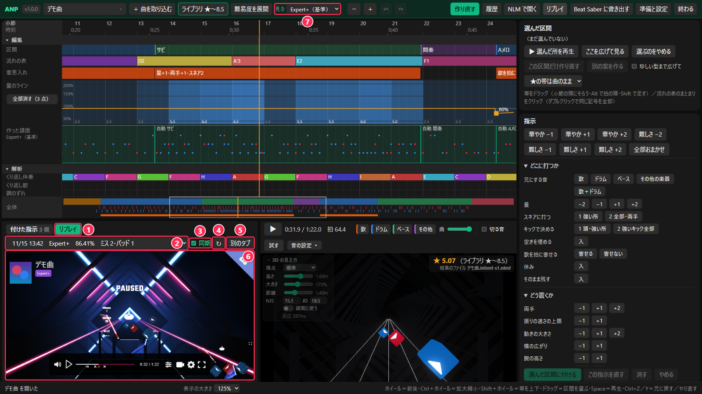

| 番号 | 欄の物 | 何をするか |
|---|---|---|
| ① | 見出しの「リプレイ」 | 「付けた指示」と切り替えます |
| ② | リプレイを選ぶ欄 | この曲のリプレイ（遊んだ日時・難易度・精度・ミス）から選びます |
| ③ | 同期 | 入れると、リプレイとアプリの再生位置をそろえます（初めは入っています。つないでいる間は字が緑になります） |
| ④ | ↻ | 一覧を読み直します（遊んだ直後など）。開いたリプレイが読み込めていない時は、開き直します |
| ⑤ | 別のタブ | このリプレイをブラウザの別のタブで大きく開きます（同期しません） |
| ⑥ | BL のリプレイアプリ | リプレイが流れます。下の棒で再生・停止・時刻を動かせます（同期している間は、アプリの帯・3D も付いてきます） |
| ⑦ | 見る | 開いたリプレイの難易度に変わります（下の「難易度」） |

**同期している間**

- リプレイを再生・停止したり、リプレイの時刻の棒を動かしたりすると、アプリの帯・3D・時刻が付いてきます。
- アプリで位置を変える（帯をクリック・← → ・Home・付けた指示の ▶ など）と、リプレイも動きます。
- アプリの ▶ と Space は、リプレイを再生・停止します。選んだ区間の再生は、区間の終わりでリプレイを止めます。
- 音はリプレイの音（切る音入り）です。アプリの分けた音と 3D の切る音は鳴りません。
- 「同期」を外すと、リプレイとアプリは別々に動きます。欄を「付けた指示」に戻すと、リプレイを止めて、アプリの音に戻ります。

ミスした所でリプレイを止めて、帯でその小節をドラッグして選べば、同期したまま右の欄で指示を付けられます。

**難易度**

リプレイを開くたびに、上の列の「見る」がそのリプレイの難易度に変わります（帯「作った譜面」・3D・★がその難易度になります）。
派生の難易度なら、見ている間は編集できません（[8 章](#8-難易度を作り分ける展開)）。指示は、基準の難易度に戻ってから付けます。
今の曲にその難易度の譜面が無い時や、履歴の版・別の案を見ている時は、「見る」は今のままです（欄に知らせが出ます）。

**途中でやめたプレイ**

途中でやめた（ポーズからメニューに戻った・やり直した）プレイには、一覧に灰色の「やめた」の札が付きます。
左下の欄では、記録が終わった所（やめた所）で再生が止まります（開いた時に「途中でやめたプレイ: 0:03.9 まで…」のように出ます）。
途中で失敗して終わったプレイも、同じように記録の終わりで止まります。

**アプリの 3D との違い**

- リプレイは遊んだ時の見え方（ゲームで設定した JD）で流れ、アプリの 3D は譜面の NJS・JD で流れます。ノーツが見え始める距離が違うことがありますが、切る時刻は同じです。
- 遊んだ後に NLM で無音追加や曲の位置を変えた時は、その分だけリプレイとアプリの位置がずれます。

> BL のリプレイアプリが 25 秒たっても読み込めない時は、欄に知らせが出ます。↻ で開き直してください。

---

## 11. NLM で仕上げる

作った譜面は NLM のプロジェクトファイル（.nlmf）なので、NLM で開いて手直し・ライティングができます。
準備の窓で NLM の場所を決めると、上の列の「NLM で開く」が押せるようになります。

NLM で直した所は、アプリで作り直しても**消えません**。

| NLM でやること | 作り直した時 |
|---|---|
| 作ったクリップの中身を直す（ノーツを動かす・足す・消す） | そのクリップは残ります（直した物として見分けます） |
| 直していないが気に入ったクリップの名前に「固定」と入れる | そのクリップは残ります |
| 要らない所のクリップを消す | その所は空のまま（ノーツを置きません） |
| 自分でクリップを作る | 残ります |
| ライティング | 触りません |

作り直す前に NLM で保存し直されていた時は、上書きの前に控え（作業フォルダの `out\old\`）を取ります。
アプリの帯「作った譜面」では、NLM で直したクリップに色が付きます。区間ごと守りたい時は、意思入れの「そのまま残す」も使えます。

---

## 12. 設定・作業フォルダの引っ越し・更新

### 準備と設定

上の列の「準備と設定」で、いつでも準備の窓を開けます。NLM の場所を変えたり、音を分ける部品をインストールし直したりできます。

### 作業フォルダの引っ越し

作業フォルダを別の場所（別のドライブなど）へ移したい時は、準備の窓の「作業フォルダを引っ越す…」を押します。

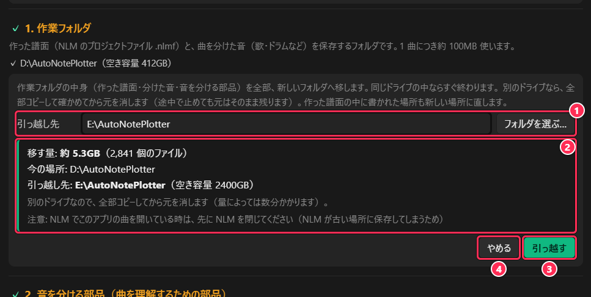

| 番号 | 何が出ているか・何をするか |
|---|---|
| ① | 引っ越し先（空のフォルダか、まだ無い名前） |
| ② | 見積もり（移す量・今の場所・引っ越し先の空き容量・かかる時間の目安・注意） |
| ③ | 引っ越す |
| ④ | やめる |

- 同じドライブの中なら、すぐ終わります。別のドライブなら、全部コピーして確かめてから元を消します（途中で止めても元は残ります）。
- 作った譜面の中に書かれた場所（音源・カバー画像）も、新しい場所に直します。
- NLM でこのアプリの曲を開いている時は、先に NLM を閉じてください。

アプリ本体（展開したフォルダ）は、フォルダごと別の場所へ移してかまいません（設定と作業フォルダはアプリの外にあります）。

### アプリの更新

起動した時に新しい版があれば、右上に知らせが出て、版のボタンに色が付きます。

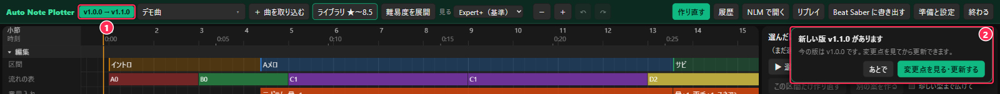

| 番号 | 何が出ているか |
|---|---|
| ① | 版のボタン（今の版 → 新しい版） |
| ② | 「新しい版があります」の知らせ（あとで・変更点を見る・更新する） |

版のボタンを押すと、更新の窓が開きます。

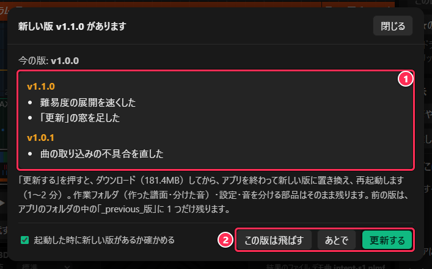

| 番号 | 何が出ているか・何をするか |
|---|---|
| ① | 変更点（今の版より新しい版の分） |
| ② | この版は飛ばす・あとで・更新する |

- 「更新する」を押すと、ダウンロードして確かめ、アプリを入れ替えて起動し直します。作業フォルダ・設定・音を分ける部品はそのままです。
- 窓の左下の「起動した時に新しい版があるか確かめる」で、起動した時の確認を切れます。
- 前の版は、アプリのフォルダの `_previous_<版>` に 1 つだけ残ります。
- 急いで入れてほしい更新や、使ってはいけない版が見つかった時は、起動のたびに知らせが出て、版のボタンに ⚠ が付きます（「この版は飛ばす」は出ません）。早めに更新してください。

### 音を分ける部品の更新

音を分ける部品は、アプリの版ごとに動作を確かめた組み合わせがあります。

- 上の列の「準備と設定」に小さな印が付き、準備の窓に「おすすめの状態ではありません」と出た時は、部品の一部の版が、確かめた組み合わせと違います。
  今のままでも使えます。「更新する」を押すと、違う部品だけをダウンロードし直します（「あとで」で後回しにできます）。
- 部品の版が古すぎる・使ってはいけない版が入っている時は、準備の窓が開き、更新が済むまで新しい曲を取り込めません。
- 「アプリの更新が必要です」と出た時は、部品の入れ直しでは直りません。「アプリの更新を確かめる」から、新しい版のアプリに更新してください。

---

## 13. 困った時は

**音を分ける部品のインストールが途中で止まった**
もう一度アプリを開くと準備の窓が出ます。「続きからインストールする」を押すと、ダウンロード済みの所から再開します。

**「空き容量が足りない」と出る**
インストール先を、空きのあるドライブにしてください（GPU 版はインストール中に最大で約 8GB 使います）。

**曲を分けるのが遅い**
CPU 版は GPU 版より時間がかかります（4 分の曲で約 5 分）。NVIDIA のグラフィックボードがあるのに CPU 版をすすめられた時は、
グラフィックボードのドライバーを新しくしてから、準備の窓の「インストールし直す…」で GPU 版を選んでください。

**起動した時に、画面が上の列だけのまま止まった**
起動した直後の Windows の一時的な不調で、画面の部品を読めないことがあります。アプリが気付いて読み込み直します。それでも直らない時は、アプリを閉じて開き直してください。

**Beat Saber の曲のフォルダが見つからない**
書き出しの窓の「別のフォルダを選ぶ…」で `CustomLevels` のフォルダを選んでください
（Steam 版なら `Beat Saber\Beat Saber_Data\CustomLevels`、BSManager なら `SharedContent\SharedMaps\CustomLevels`）。

**書き出した曲がゲームに出てこない**
Beat Saber を起動したままの時は、曲の一覧を読み直してください。それでも出ない時は、書き出し先が今遊んでいる Beat Saber の `CustomLevels` か確かめてください。

**リプレイが一覧に出ない**
リプレイは、Beat Saber に BeatLeader の Mod を入れて遊んだ時だけ残ります。「リプレイの置き場が見つかりません」と出た時は、リプレイの窓の「リプレイの置き場」に
`<Beat Saber のフォルダ>\UserData\BeatLeader\Replays` を入れてください。遊んだ直後のリプレイが出ない時は、リプレイの窓を開き直すか、左下の欄の ↻ で読み直してください。
「この曲」に出ない時は、その曲を Beat Saber に書き出してから遊んだか確かめてください（「全部の履歴」にはどの曲のリプレイも出ます）。

**リプレイが開けない**
一覧の「譜面」が「譜面が無い」の時は、遊んだ時の譜面が見つかりません。BeatSaver の譜面は、BeatSaver から譜面をダウンロードするのでインターネットが要ります（BeatSaver で消された版は開けません）。

**「NLM で開く」が押せない**
準備の窓で NLM（`NonLinearMapper.exe`）の場所を選んでください。

**区間の名前や境目がおかしい**
NLM で開いてマーカー（区間）を直して保存し、アプリで作り直してください。

---

ここまでで、曲を取り込んで方針を決め、Beat Saber で遊ぶまでの流れは一通りです。遊んだらリプレイで気になった所を見つけて意思入れを足し、作り直す、をくり返してください。
